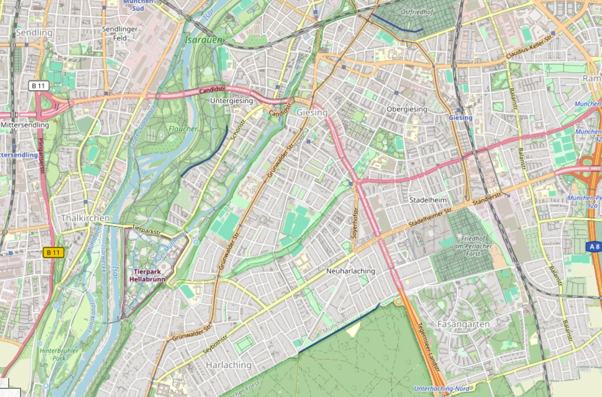
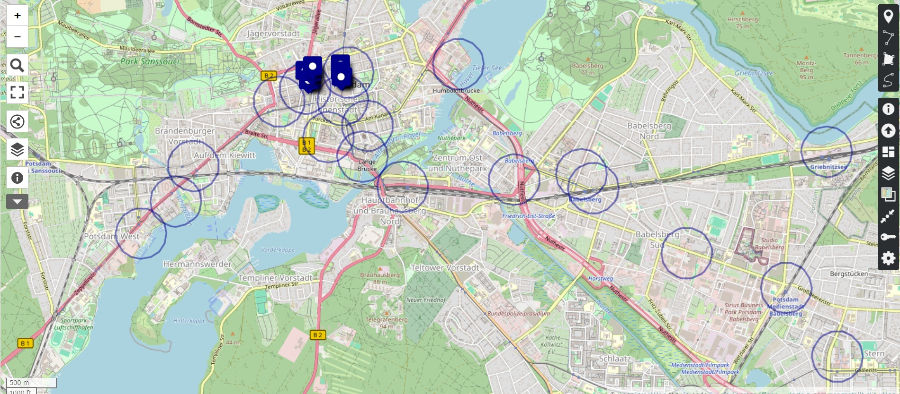
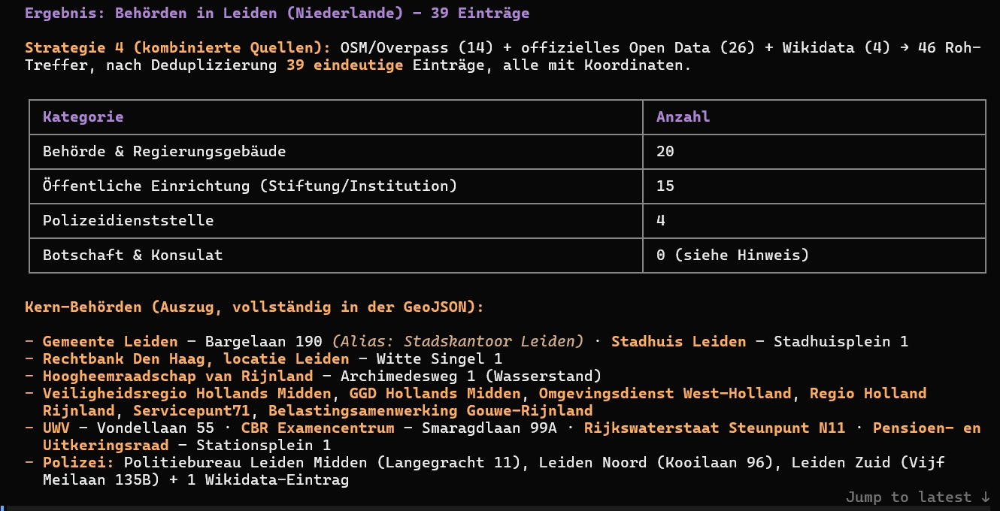
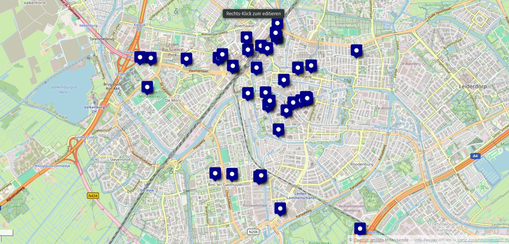
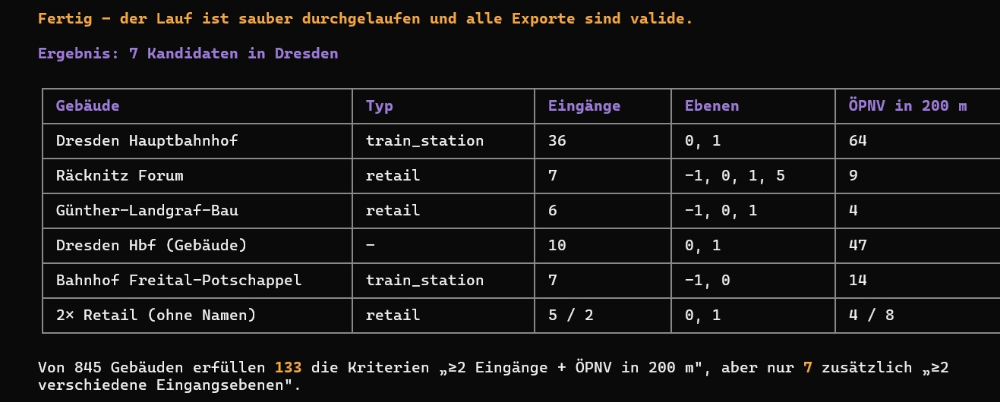
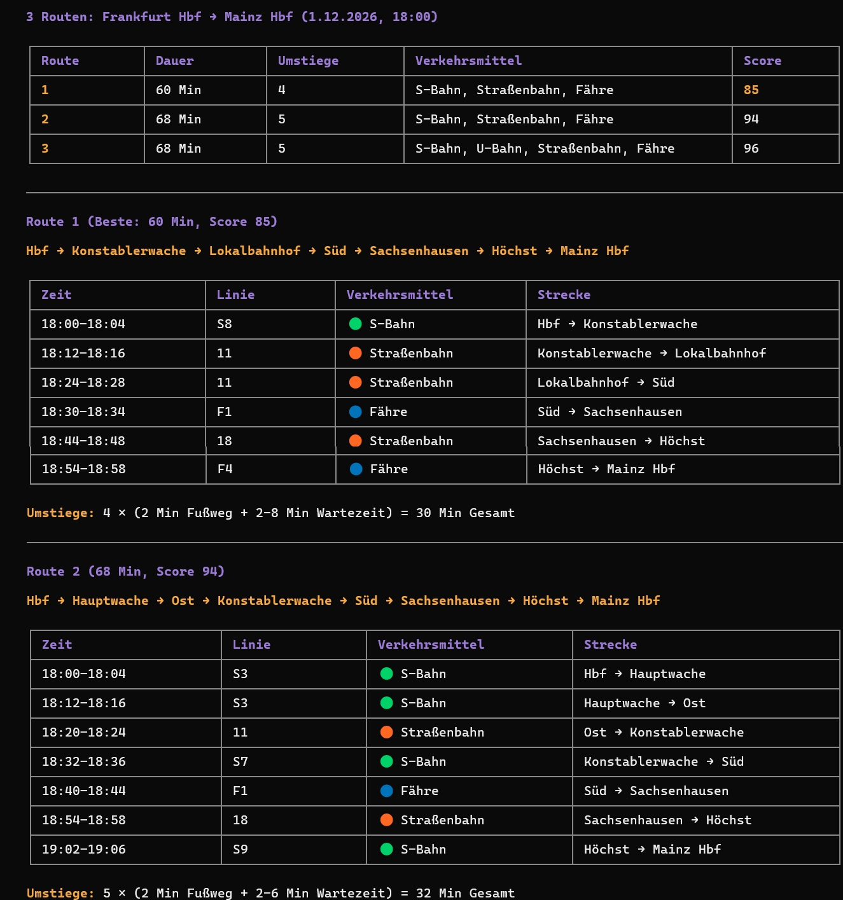

# exploreGeoStructures
Ein KI Assistent, der nach besonderen geographischen Strukturen und Bewegungsmustern sucht, die sich für Spiele wie Schnitzeljagd gut eignen.

# Projekt

* `tasks` - Hier untersuchen wir neue tasks, entwickeln und verbessern die Strategie. Wenn ein akzeptables Einstiegsniveau erreicht ist, wird ein skill erzeugt.
* `tasks/MallsEtc` - sucht nach Einkaufszentren, Bahnhöfen und Passagen, die gewisse Anforderungen erfüllen
* `tasks/ÖPNVRundfahrt` - stellt eine Reise als Abfolge von öffentlichen Verkehrsmitteln zusammen, die gewisse Anforderungen erfüllt. Das Ergebnis wird in einer Karte dargestellt.
* `AGENTS.md` - zentrale Anweisungen (Nutzung python venv, Visualisierung auf Karten mittels kml-files für openstreetmap, ...)
* `.opencode/skills` - hier sind skills definiert, die einen gewissen Reifegrad haben. Mit "/skills" kann man sie in opencode auflisten
und mit "@" einen einzelnen Skill benutzen
* `.opencode/skill/fussweg` - sucht einen möglichst geraden Fußweg ohne parallele Verkehrswege und ohne Abzweigungen von gewisser Länge bzw. Passierdauer
* `.opencode/skills/behoerdenetc` - sucht nach Behörden, Botschaften, Polizeidienststellen etc. in einer Stadt oder einem Stadtteil
* `.opencode/skills/belebteOrte` - sucht nach Orten in einer Stadt oder einem Stadtteil, die in einem Zeitfenster besonders belebt sind

# Design der Skills

Die skills sind die zentralen und wichtigsten Teile. Jeder Skill besteht aus einer `SKILL.md`-Datei, die den Skill, seinen Ablauf, seine Ein- und Ausgabe definiert. Daten, die hierfür benötigt werden, wie Formatvorgaben, Regeln, etc. sind in files im Verzeichnis `reference` ausgelagert und werden in der SKILL.md referenziert. Siehe [Claude code Skill Architecture](https://www.mindstudio.ai/blog/claude-code-skills-architecture-skill-md-reference-files)

Die Skills sind als [self-improving skills](https://www.mindstudio.ai/blog/self-improving-ai-skills-claude-code) angelegt. Länder und Städte haben unterschiedliche Datenquellen für Geodaten. Die Zugriffe auf solche Dienste variieren ebenfalls. Solche Erkenntnisse speichert sich der skill am Ende und fragt den Nutzer nach einem feedback.

# Wie nutzt man das Paket?
## Voraussetzungen
1. Linux Rechner am Internet
2. opencode V2 installiert
3. python3 installiert

## Installation
1. Download mittels `git clone git@github.com:Steffen531/exploreGeoStructures.git`
2. Im obersten Verzeichnis `exploreGeoStructures` ein Python virtual environment mittel `python3 -m venv venv` anlegen

## Erste Schritte
1. `opencode` ausführen
2. Mit `/skills` skills anzeigen: es sollten die oben beschriebenen skills zu sehen sein
3. Eine erste Aufgabe stellen wie z.B. "Suche Behörden in Bochum"
   
# Beispiele

## Einsame Fußwege in München Giesing

## Die belebtesten Orte in Potsdam Sonntag abends

## Behörden, Botschaften & Co. in Leiden (Niederlande)

## Malls, Bahnhöfe u.ä. in Dresden

## Eine 1-stündige ÖPNV-Rundfahrt am 1.12.26 in Frankfurt a.M. ab 18:00 Uhr

# Nächste Schritte
1. Die Taks für ÖPNV Rundfahrt und MallsEtc als skill umsetzen
2. Die Visualisierung der ÖPNV-Routen passt nicht: falsche Orte, keine Zwischenhalte
